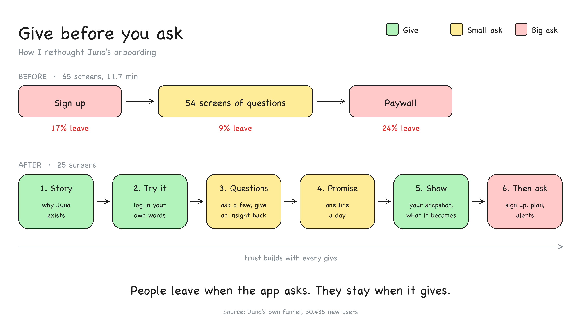

# Juno onboarding

A redesign of the onboarding for [Juno](https://www.ycombinator.com/launches/QT7-juno-ai-health-assistant-for-chronic-illness), an AI health assistant for people with chronic illness. Built in Expo as a working prototype; sign-in, purchase, Health access and notifications are mocked.



The idea in one line: people leave when the app asks and stay when it gives. Juno's own funnel (30,435 new users) shows the biggest drops at sign-up (17%) and the paywall (24%), and 71% of people try the logging demo when it's offered. So the new flow gives something back first, and asks later.

## The flow

| Part | Screens | What it gives or asks |
| --- | --- | --- |
| Start | Welcome, Story, Consent | Why Juno exists: months for an appointment, then 15 minutes; the founders' own stories |
| Today | How do you feel? → Juno heard you | Log in your own words; Juno pulls out the symptoms and saves entry 1 |
| Your health | Goals, Conditions, Symptoms, Medicines → fact card | A sourced fact, what Juno knows so far, the doctor page filling up |
| Your days | Appointment, Energy → **Pacing**, Support → **Community** → fact card | What Juno does with your energy; groups you can join |
| You | About you, Apple Health, Where did you find Juno? | |
| Your routine | One line a day? → check-in demo → **growth graph** | A rehearsal of tomorrow's check-in, and what daily entries add up to by your appointment |
| Your snapshot | Building, Snapshot, Doctor page, Save | Everything you told Juno, then the page your doctor will see |
| Your plan | How Juno works, Plans | Free trial with real dates; the free plan is a visible choice |
| End | Done → Daily check-in → first chat | The commitment: what you do each day, when Juno reminds you, then the notification permission |

The sentence typed on "How do you feel?" carries through to the symptoms list, the snapshot, the doctor page and the first chat.

## What changed from the current app

- **Value before account.** Sign-up moved from screen 2 to after the snapshot, framed as saving what you built.
- **Give back after each block.** Every few questions end with something back: Juno's reply, a sourced fact, the doctor page meter.
- **A real commitment.** One line a day, a demo of the check-in, then the reminder ask, placed at the end where it makes sense.
- **Honest numbers.** Only sourced facts (`src/copy/facts.ts`) and numbers computed from the user's own answers. The production graph charts "how you feel" rising; this one charts entries, so it never promises the user will feel better.
- **Cherry-picked from the production app:** pacing, community groups, "where did you find Juno?" and the evolving graph. Left out: questions that repeat ones we already ask, the mid-flow rating prompt, and screens with numbers we couldn't source.

## Why it looks and works this way

**Why 25+ screens and not ~20?** Each extra screen gives something back (a reply, a fact, a preview) rather than asking more. Most take one tap, and every question has a skip or "not sure" answer.

**Icons and tables.** Every choice row has an icon so options read at a glance. Facts and recaps use small table-like cards: "What I know so far", the snapshot rows, the example week on Pacing, the doctor page preview and the trial dates next to the price.

**Micro-interactions.** Each tap gets a response: a haptic, a small pop on the picked option, and Juno's reply at the bottom. The growth graph ticks as each bar lands. They confirm the tap; none of them block Continue.

**People in their 40s and up, and people who are tired or in pain.** Text grows with the phone's font setting, tap targets are at least 44 pt, everything works with taps only (no typing needed), Reduce Motion turns animation into simple fades, and Juno's replies are announced to VoiceOver. Copy is one short line per idea.

## Implementation notes

- **Stack:** Expo SDK 58, Expo Router, React Native 0.88, Reanimated 4, Gesture Handler. State is a small React context saved to AsyncStorage, so the flow resumes where you left off.
- **Look:** colours, type and spacing were sampled from the Figma frames (`src/theme/tokens.ts`). Figma had flat screens only, so icons and art were cut out of the exports (`assets/juno/`, `docs/ASSETS.md`); a few icons came from the production app's screens.
- **Feel:** a light haptic on every button press, a selection haptic and small pop on picks, typing dots before Juno replies, a breathing mascot, and title-led screen entrances. Every animation has a Reduce Motion path.
- **Copy** lives in `src/copy/strings.ts`, facts with their sources in `src/copy/facts.ts`.
- **Debug menu:** long-press the Juno logo to reset, fill demo answers, or jump to any screen.

## Checks

```bash
bun install
bunx expo start                         # press i for the iOS simulator
bunx tsc --noEmit && bunx expo lint
bun scripts/eval/unit.ts                # plus insights.ts, meter.ts
maestro test scripts/eval/maestro/full_flow.yaml   # taps through every screen
python3 scripts/eval/layout_shift.py    # fails if anything on screen moves after it renders
```

Not verified: Android, and how the haptics feel on a real phone (they are checked in code only).

## Publishing the web version

```bash
./scripts/web-export.sh
bunx eas-cli deploy --prod --export-dir dist
```
